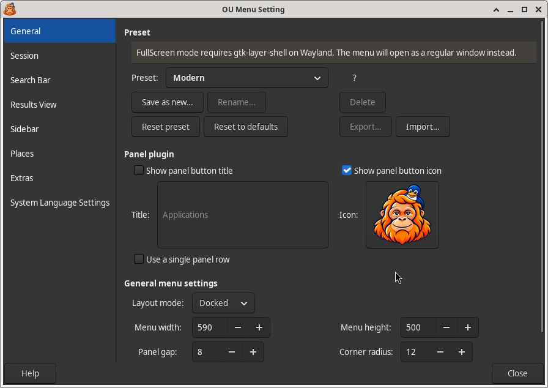

# OU Menu

A customized panel application launcher for the [Xfce](https://xfce.org/) desktop, made for OU Linux.

OU Menu is based on **Meow Menu** by Matteo Bonanomi
(https://github.com/matteobonanomi/xfce4-meowmenu-plugin), which is itself a fork
of **Xfce Whisker Menu** by Graeme Gott. This project keeps the upstream
GPL-2.0-or-later license; see [COPYING](COPYING) for the full license text and
copyright notices.

## About OU Linux

OU Menu is developed as the application launcher for **OU Linux (Orang Utan Linux)**,
a Debian 13 based distribution in the Akar (Alpha) series. See the
[OU Linux repository](https://github.com/PatrickNoFilter/ou-linux-akar) for the
distribution, ISO details, and screenshots.



## What is different here

- OU Menu branding: dialog title, plugin name, and OU Linux logo.
- Custom panel button icon using the OU Linux mascot.
- A **System Language Settings** tab in Properties for selecting the session
  language through `~/.xsessionrc`.
- An **OU Menu Setting** entry in the desktop right-click menu, directly below
  *Desktop Settings*.
- A clickable **OU Menu Setting** entry and an **Applications** entry in the
  panel icon's right-click menu; the default *Properties* entry is removed.
- Panel-side remote event support used by `xfce4-popup-meowmenu --settings`.

## Build

```bash
meson setup build
meson compile -C build
meson install -C build
```

After installation, restart the panel with `xfce4-panel -r`.

## Credits

- [Xfce](https://xfce.org/) — the desktop environment and panel this plugin is built for.
- [Meow Menu](https://github.com/matteobonanomi/xfce4-meowmenu-plugin) — Matteo Bonanomi
- [Xfce Whisker Menu](https://gitlab.xfce.org/panel-plugins/xfce4-whiskermenu-plugin) — Graeme Gott, original Whisker Menu

This project remains licensed under GPL-2.0-or-later.
